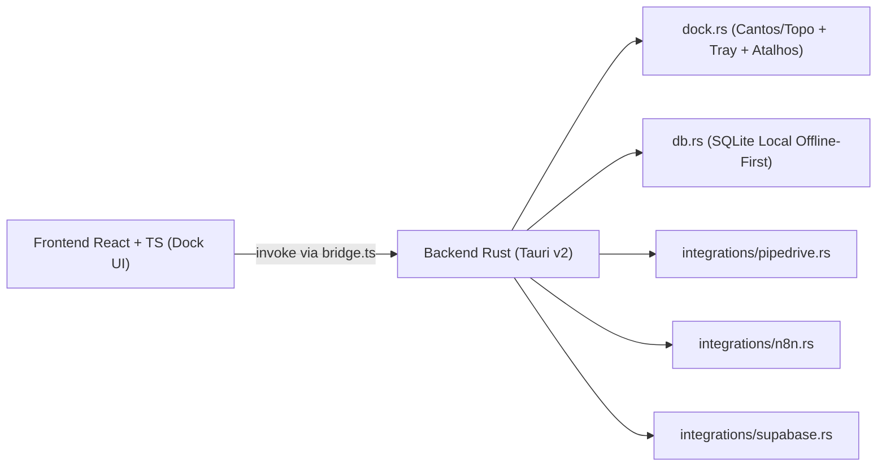

# Arquitetura — QuickNote CRM

## Visão em Camadas



## Estrutura de Pastas Planejada

```text
quicknote-crm/
├── AGENTS.md
├── docs/
│   ├── README.md
│   ├── blueprint.md
│   ├── architecture.md
│   ├── data-model.md
│   └── integrations.md
├── src/                        # Frontend React + TypeScript + Tailwind
│   ├── components/             # Editor, checklist, seletor de deal, toasts
│   ├── lib/
│   │   └── bridge.ts           # Contrato único de IPC com o backend Rust
│   └── App.tsx
└── src-tauri/                  # Backend Rust (Tauri v2)
    └── src/
        ├── main.rs
        ├── lib.rs
        ├── dock.rs             # Posicionamento nos cantos/topo, tray e atalhos globais
        ├── db.rs               # Conexão e queries SQLite
        ├── commands.rs         # Comandos #[tauri::command] expostos ao frontend
        └── integrations/
            ├── mod.rs
            ├── pipedrive.rs
            ├── n8n.rs
            └── supabase.rs
```

## Registro de Decisões (ADRs)

| Data | Decisão | Motivo |
| :--- | :--- | :--- |
| 2026-11-18 | Tauri v2 + Rust como stack principal | Menor consumo de RAM/binário para app residente em dock/tray durante o dia todo. |
| 2026-11-18 | Perfil local + token no MVP (sem fluxo completo de login) | Garante rastreabilidade por membro de CS sem atrasar a entrega funcional inicial. |
| 2026-11-18 | SQLCipher e `keyring` postergados para v1.1+ | Reduz atrito inicial de build no Windows/MSVC enquanto valida o fluxo ponta a ponta. |
| 2026-11-18 | Toda chamada HTTP no backend Rust (`reqwest`) | Evita CORS e mantém tokens/webhooks fora do bundle React. |
