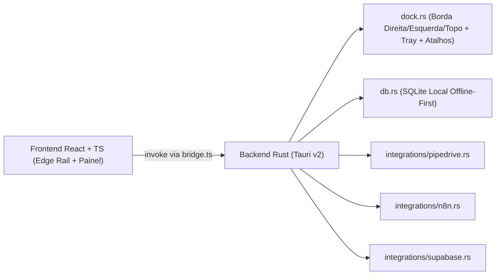

# Arquitetura — QuickNote CRM

## Visão em Camadas



## Estrutura de Pastas Atual e Planejada

```text
quicknote-crm/
├── AGENTS.md
├── docs/
│   ├── README.md
│   ├── blueprint.md
│   ├── architecture.md
│   ├── data-model.md
│   └── integrations.md
├── src/                        # Frontend React + TypeScript + Tailwind
│   ├── components/
│   │   ├── DockRail.tsx        # Barra minimalista ancorada na borda
│   │   ├── DockPanel.tsx       # Painel expandido (notas, tarefas, ajustes)
│   │   └── ProfileSettingsCard.tsx # Configuração do perfil CS ativo
│   ├── lib/
│   │   └── bridge.ts           # Contrato único de IPC com o backend Rust + fallback web
│   └── App.tsx                 # Estado do dock, hidratação e autosave com flush
└── src-tauri/                  # Backend Rust (Tauri v2)
    └── src/
        ├── main.rs
        ├── lib.rs
        ├── dock.rs             # Encaixe nas bordas (right/left/top), recolher/expandir, drag-snap, tray e atalhos
        ├── db.rs               # Conexão SQLite (WAL + FKs) e CRUD de notes, todos e cs_profile
        ├── commands.rs         # Comandos #[tauri::command] expostos ao frontend
        └── integrations/       # Próximo marco (Pipedrive, n8n, Supabase)
            ├── mod.rs
            ├── pipedrive.rs
            ├── n8n.rs
            └── supabase.rs
```

## Registro de Decisões (ADRs)

| Data | Decisão | Motivo |
| :--- | :--- | :--- |
| 2026-11-18 | Tauri v2 + Rust como stack principal | Menor consumo de RAM/binário para app residente em dock/tray durante o dia todo. |
| 2026-11-18 | Perfil local + token no MVP (sem fluxo completo de login) | Garante rastreabilidade por membro de CS sem atrasar a entrega funcional inicial. |
| 2026-11-18 | SQLCipher e `keyring` postergados para v1.1+ | Reduz atrito inicial de build no Windows/MSVC enquanto valida o fluxo ponta a ponta. |
| 2026-11-18 | Toda chamada HTTP no backend Rust (`reqwest`) | Evita CORS e mantém tokens/webhooks fora do bundle React. |
| 2026-11-18 | Barra minimalista colada na borda (`right`/`left`/`top`) com janela transparente única | Reduz intrusão visual durante reuniões mantendo expansão instantânea para notas, tarefas e ajustes. |
| 2026-11-19 | `rusqlite` com feature `bundled`, `WAL`, `PRAGMA foreign_keys = ON` e `ON CONFLICT DO UPDATE` | Elimina dependência de DLL SQLite no Windows, protege integridade referencial e evita que `INSERT OR REPLACE` apague tarefas vinculadas via `ON DELETE CASCADE`. |
| 2026-11-19 | Token do perfil CS write-only na fronteira IPC | `set_active_profile` grava o token no SQLite e `ActiveProfile` devolve apenas `hasToken` e `isConfigured`, mantendo o segredo isolado no backend Rust. |
